> [!NOTE]
> **졸업작품 제출본입니다.**
> - 먼저 보실 문서와 제외한 항목 → [제출본_안내.md](제출본_안내.md)
> - 발표자료 · 보고서 → [docs/최종발표/](docs/최종발표/)

## 서비스 화면 — [rookiezpark.com](https://rookiezpark.com)

| | |
| :-: | :-: |
| 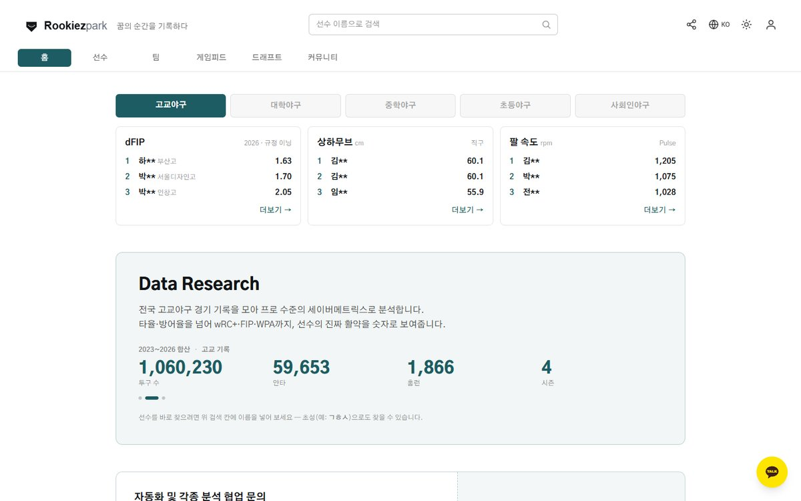<br>**홈**<br>리더 요약 · 데이터 소개 | 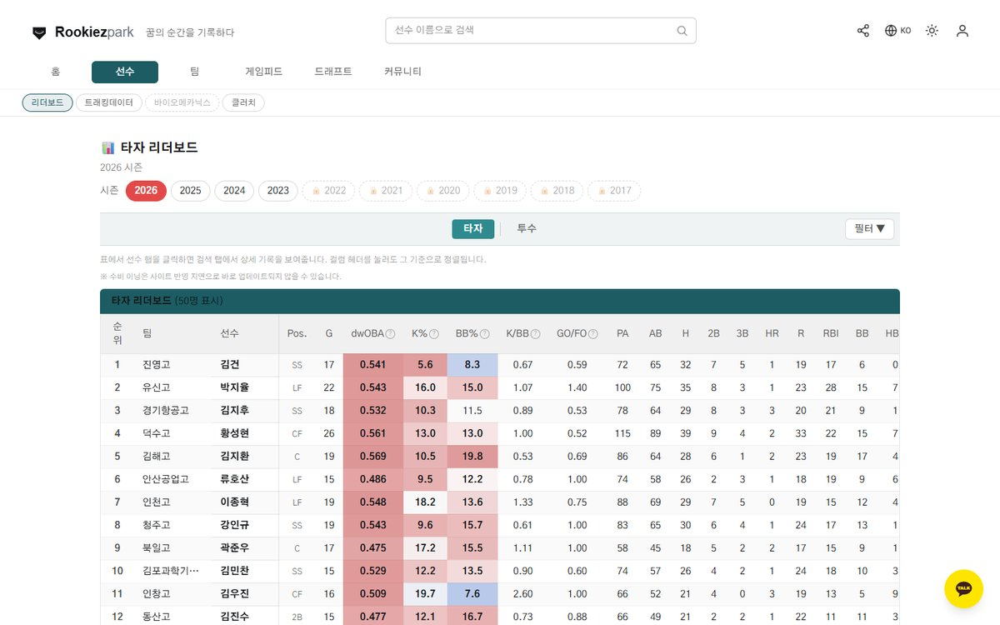<br>**타자 리더보드**<br>리그 안 순위를 색으로 표시 |
| 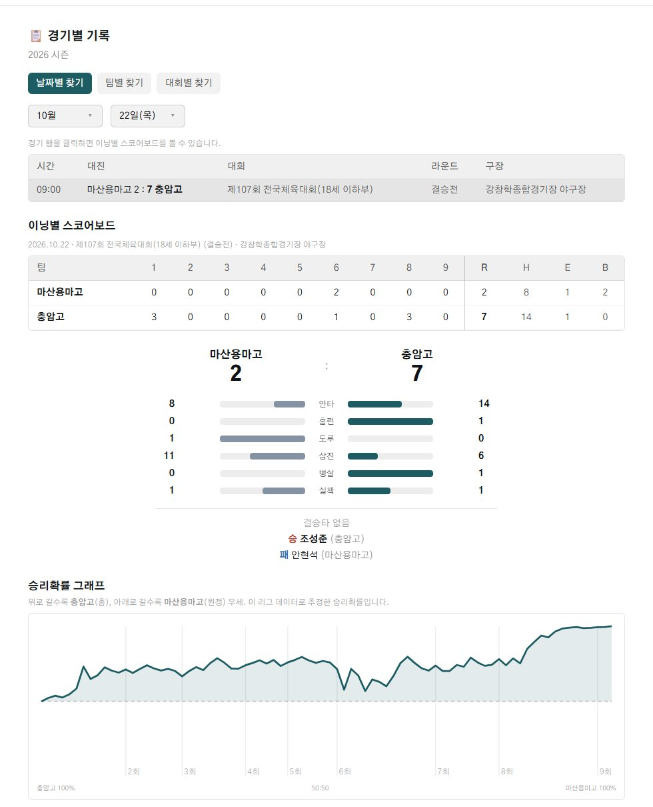<br>**경기별 기록**<br>이닝별 스코어 · 승리확률 그래프 | 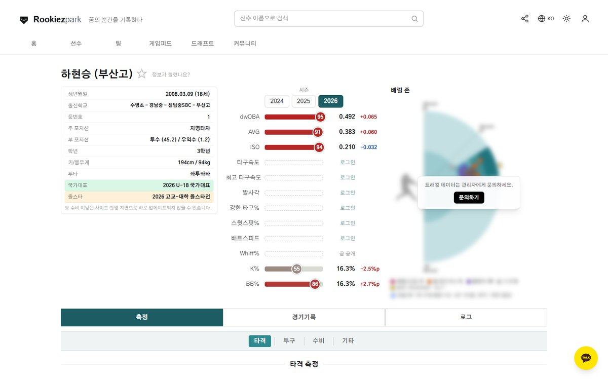<br>**선수 상세**<br>시즌 지표 · 같은 학년 안 백분위 |
| 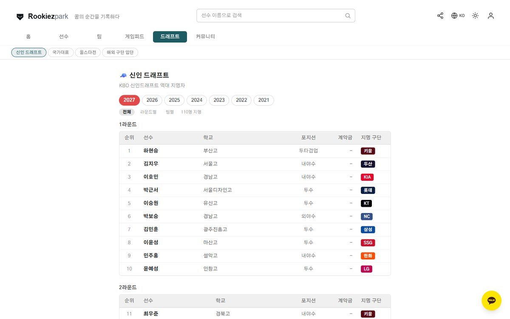<br>**신인 드래프트**<br>역대 지명자 · 계약금 | 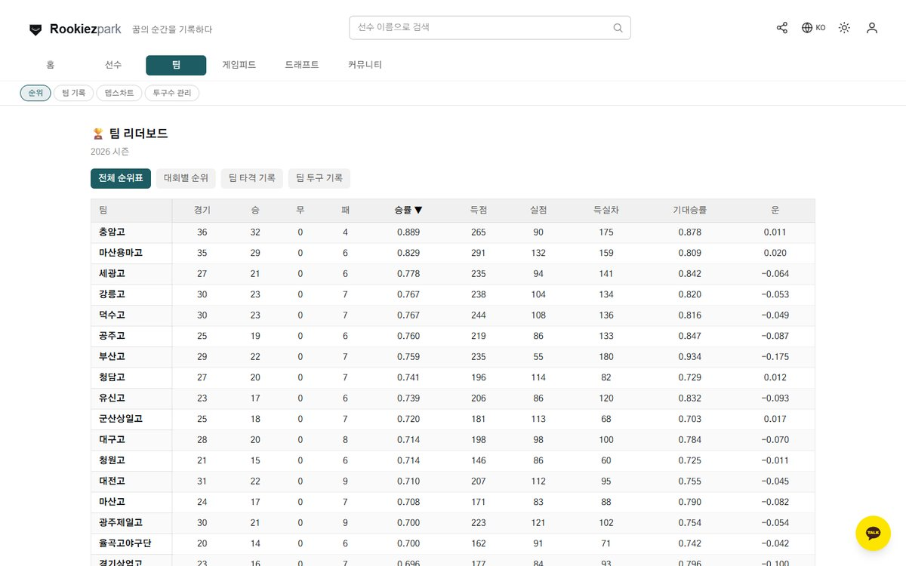<br>**팀 순위**<br>기대승률 · 대회별 순위 |
| 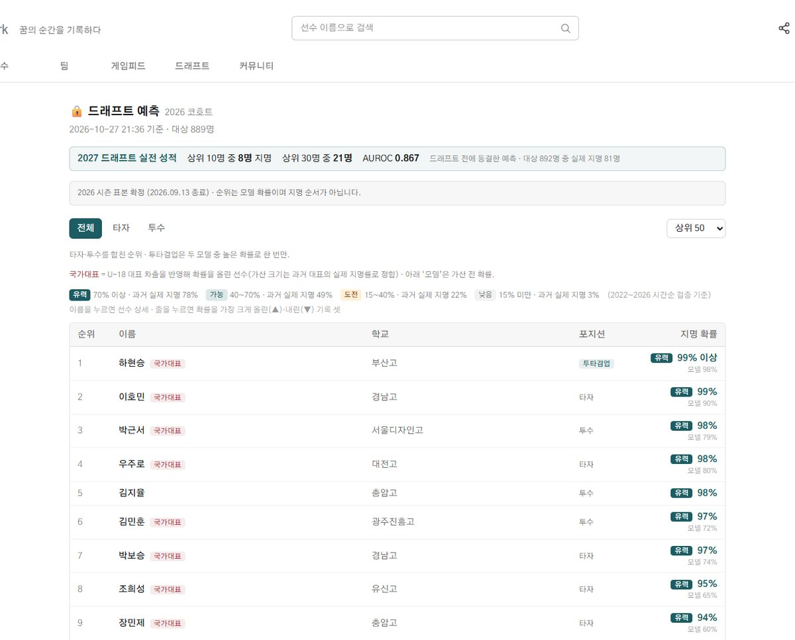<br>**드래프트 예측** (로그인 전용)<br>지명 확률 · 등급 · 실전 성적 | |

- 보안 유지를 위해 일부 기능의 데이터와 연결 정보는 제외하였습니다.
- 제외한 항목 → [제출본_안내.md](제출본_안내.md)
- 실제 동작 → [rookiezpark.com](https://rookiezpark.com)

<div align="center">

# ⚾ Rookiezpark

**꿈의 순간을 기록하다** — 대한민국 고교야구 기록 수집·검증·분석 파이프라인

[](https://nextjs.org)
[](https://react.dev)
[](https://python.org)
[](https://pandas.pydata.org)
[](https://lightgbm.readthedocs.io)
[](https://vercel.com)

<sub>설계 · 파이프라인 문서 · 2026-10-04 기준</sub>

**처음 합류하셨나요?** → [ONBOARDING.md](ONBOARDING.md)<br>
설치는 `python scripts/setup.py` 한 줄<br>
**커밋·푸시 방법** → [팀원 협업](#-팀원-협업--커밋푸시-하는-법)<br>
**Drive 연결·푸시까지 단계별로** → [팀원_매뉴얼.md](팀원_매뉴얼.md)

</div>

---

## 🧭 한 눈에 보는 설계도

> **사람이 고친 기록지**가 이 시스템의 원료입니다. 크롤러가 받아온 엑셀을 작업자가 손으로
> 보정하고, 코드가 그것을 아웃·점수·주자로 재현해 원본과 대조합니다. 대조가 0이 되어야만
> 다음 단계로 넘어갑니다.

### 1. 파이프라인 — 경기 하나가 사이트에 뜨기까지


| 단계 | 어디서 | 무엇으로 | 나오는 것 |
| :-- | :-- | :-- | :-- |
| ① 수집 | Colab | `1·5·6번 노트북`, `출신 크롤링` | 기록지 `xlsx` (10경기/파일), `batter_box` · `pitcher_box` · `inning_summary` |
| ② 보정 | 사람 (엑셀) | Drive + 작업자 현황 시트 | 손으로 고쳐진 기록지 |
| ③ 검수·가공 | Colab | `2-3. 통합 체크` → `run_all_pipeline(YEAR)` | `full_tracked_{YEAR}` → `season_full_{YEAR}` |
| ④ 스탯·익스포트 | 로컬 PC | `lib/*.py` + `scripts/export_*.py` (refresh_all 13단계) | `web/data/**` 약 33,000개 · 440MB (7시즌) |
| ⑤ 공개 | Vercel | Next.js 서버 컴포넌트 + `/api/*` | 사이트 |

### 2. 시스템 구성 — 무엇이 어디에 있나

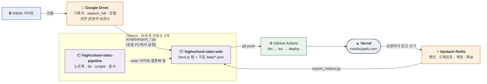

- 저장소는 **둘**이고, `web` 저장소가 `pipeline` 클론 안의 `web/` 자리에 들어갑니다. 스크립트들이 그 경로를 전제로 합니다.
- **구운 JSON 은 `web` 저장소에 함께 커밋**됩니다. 그래서 웹 개발자는 Drive 자격증명 없이 클론만으로 실데이터를 받습니다.
- 배포는 GitHub Actions 가 소유자 토큰으로 합니다. **누가 병합하든 배포됩니다** ([ONBOARDING 7절](ONBOARDING.md#7-배포)).

### 3. 계층 한 장 요약

| 계층 | 폴더 | 돌아가는 곳 | 핵심 |
| :-- | :-- | :-- | :-- |
| 0 · 원천 | — | KBSA · Drive · Upstash · 영상 · WBSC | [자세히](#계층-0--데이터-원천) |
| 1 · 수집 | `*.ipynb` | Colab | 기록지 크롤, 경기 10개마다 파일 분할 [↓](#계층-1--수집-크롤링-노트북) |
| 2 · 검수·가공 | `*.ipynb` | Colab | step1~5 + **3중 대조**, diff 0까지 반복 [↓](#계층-2--검수--가공) |
| 3 · 스탯 엔진 | [`lib/`](lib/) | 로컬 (순수 pandas) | wOBA·wRC+·FIP·RE24·WPA·투구수 규정 [↓](#계층-3--스탯-엔진-lib) |
| 4 · 익스포트 | [`scripts/`](scripts/) | 로컬 PC | `refresh_all.py` 가 13단계를 순서대로 (약 15~20분) [↓](#계층-4--익스포트-scripts) |
| 5 · 웹 | `web/` *(별도 저장소)* | Vercel | 데이터는 `public` 바깥, 클라는 `/api/*` 만 [↓](#계층-5--웹-web) |
| 곁가지 | `모델/` `분석/` `wbsc/` | 각자 | 본류와 독립, 결과만 합류 [↓](#-곁가지-파이프라인) |

### 4. 문서 지도 — 무엇을 어디서 읽나

| 문서 | 담은 것 | 주로 볼 사람 |
| :-- | :-- | :-- |
| **README.md** (이 문서) | 전체 설계·파이프라인·데이터 계약·함정 | 전원, 제일 먼저 |
| [docs/manual/](docs/manual/) | 운영 매뉴얼 PDF(사용자용). 고칠 땐 같은 폴더의 `build_manual.py` 를 고쳐 다시 생성 — 관리자용은 공개본에서 제외하였다 | 운영자 · 관리자 |
| **[ONBOARDING.md](ONBOARDING.md)** | 설치 두 줄, 역할별 준비물, 브랜치·배포·금지사항 | 새로 합류한 전원 |
| [스탯_설명_및_계산식.md](스탯_설명_및_계산식.md) | 사이트에 쓰는 지표 정의와 계산식 | 기록 · 분석 |
| [web/README.md](https://github.com/Ryong1001/highschool-stats-web/blob/master/README.md) | 웹 앱 구조와 개발 방법 | 웹 |
| [web/AUTH.md](https://github.com/Ryong1001/highschool-stats-web/blob/master/AUTH.md) | 로그인 등급·세션 쿠키 설계 | 웹 |
| [desktop/README.md](desktop/README.md) | 오프라인 드래프트 입력기 | 드래프트 운영 |

<details>
<summary><b>역할별 읽는 순서 (처음 30분)</b></summary>

<br>

| 역할 | 순서 |
| :-- | :-- |
| **기록원** | 위 설계도 ①~③ → [ONBOARDING 2·3절](ONBOARDING.md#2-시작하기--명령-두-줄) → [계층 2](#계층-2--검수--가공) → 스탯 설명 |
| **웹 개발** | 위 설계도 전체 → [ONBOARDING 2·5절](ONBOARDING.md#2-시작하기--명령-두-줄) → [계층 5](#계층-5--웹-web) → `web/README.md` → `web/AUTH.md` *(web 저장소)* |
| **파이프라인** | README 전체 → [ONBOARDING 전부](ONBOARDING.md) → [데이터 계약과 함정](#-데이터-계약과-함정) → [운영 절차](#-운영-절차) |
| **분석 · 모델** | 위 설계도 → [계층 3](#계층-3--스탯-엔진-lib) → 스탯 설명 → [곁가지 파이프라인](#-곁가지-파이프라인) |

</details>

---

## 📖 목차

<table>
<tr><td width="50%" valign="top">

**큰 구조**
- [한 눈에 보는 설계도](#-한-눈에-보는-설계도)
- [한 줄 요약](#-한-줄-요약)
- [지금까지 된 것](#-지금까지-된-것)
- [팀원 협업 — 커밋·푸시 하는 법](#-팀원-협업--커밋푸시-하는-법)
- [프로젝트 운영 방식](#-프로젝트-운영-방식)
- [전체 흐름도 (자세히)](#-전체-흐름도-자세히)
- [실행 주체와 위치](#-실행-주체와-위치)
- [저장소 배치](#-저장소-배치)

**세부 구조**
- [계층 0 — 데이터 원천](#계층-0--데이터-원천)
- [계층 1 — 수집](#계층-1--수집-크롤링-노트북)
- [계층 2 — 검수·가공](#계층-2--검수--가공)
- [계층 3 — 스탯 엔진](#계층-3--스탯-엔진-lib)

</td><td width="50%" valign="top">

**세부 구조 (계속)**
- [계층 4 — 익스포트](#계층-4--익스포트-scripts)
- [계층 5 — 웹](#계층-5--웹-web)
- [곁가지 파이프라인](#-곁가지-파이프라인)

**운영**
- [데이터 계약과 함정](#-데이터-계약과-함정)
- [운영 절차](#-운영-절차)
- [알려진 한계 · 남은 일](#-알려진-한계--남은-일)

</td></tr>
</table>

---

## 🎯 한 줄 요약

> KBSA 사이트에서 기록지를 긁어와**(수집)** → 작업자가 기록지를 손으로 보정하고**(수정)**
> → 아웃·점수·주자를 재현해 원본과 대조하고**(검수)** → 주자상황이 붙은 시즌 통합
> play-by-play를 만들고**(가공)** → 파이썬 스탯 엔진으로 지표를 계산해 정적 JSON으로
> 굽고**(익스포트)** → Next.js 사이트가 그 JSON을 API 뒤에서 잘라 내보냅니다**(공개)**.

---

## ✅ 지금까지 된 것

<sub>2026-10-04 기준. 세부 이력은 `git log` 에 있습니다.</sub>

| 영역 | 상태 | 내용 |
| :-- | :-- | :-- |
| 수집·검수 | ✅ 운영 중 | KBSA 기록지 크롤 → 사람 보정 → 3중 대조(diff 0) → `season_full`. 7시즌(2020~2026) |
| 스탯 엔진 | ✅ 운영 중 | wOBA·wRC+·FIP·dFIP·RE24·WPA·LI·BsR·oWAR. 선형가중치는 **이 리그 RE24** 에서 직접 추정 |
| RE24 | 🆕 10-02 | 상태 전이(마르코프)로 다시 풀어 3루타 > 홈런 역전을 바로잡음. 승부치기는 전용 표 ([전환 메모](RE24_마르코프_전환_20261002.md)) |
| 타자·투수 표 | 🆕 10-02 | K%·BB%(타자 쪽 포함) · K/BB · GO/FO · ISO · HR% · oISO 추가 |
| 경기 기록표 | 🆕 09-28 | 초 공격 팀부터 담도록 정렬 |
| 국가대표 | 🆕 09-25 | U-18 대회 기록, 투구수를 대회 규정대로 집계, 나라 이름 한글화 |
| 주루·도루 | ✅ 09-23 | BsR·비율 oWAR·도루 시도율·SB%, 팀 번트·도루 비율 |
| 드래프트 예측 | ✅ 09-21 | LightGBM, OOF 로 확률 눈금 보정, 상위 100 채점, 국가대표 가산 **실측 검증** |
| 드래프트 입력기 | ✅ 09-23 | 한 창 입력기 (드래프트 + 국가대표·올스타·해외 입단 명단) |
| 웹 | ✅ 운영 중 | rookiezpark.com — 랭킹·순위·팀·경기·선수·비교·클러치·투구수 관리·영문판(`/en`)·로그인 3등급 |
| 홍보물 | ✅ 09-24 | 링크 미리보기(og:image), 인스타 카드(`카드/만들기.py`), 리더보드 카드 |
| 곁가지 | 🧪 실험 | 파크팩터(관리자·파트너) · WBSC(U-18 대회 기록·2026 경기 상세만 웹에) |

남은 일은 맨 아래 [알려진 한계 · 남은 일](#-알려진-한계--남은-일)에 있습니다.

---

## 🤝 팀원 협업 — 커밋·푸시 하는 법

> [!TIP]
> 처음이라면 **[팀원_매뉴얼.md](팀원_매뉴얼.md)** 를 따라 하세요. 초대 수락부터 다른 계정일 때의
> Drive 연결(바로가기), PC 에 남은 다른 GitHub 로그인 정리, VS Code 버튼으로 푸시하는 법까지
> 단계별로 있습니다. 아래는 요약입니다.

### 0. 권한 받기 (저장소 주인이 한 번)

두 저장소 모두 **비공개**라, 팀원이 푸시하려면 저장소 주인(`Ryong1001`)이 초대해야 합니다.

1. GitHub → 저장소 → **Settings → Collaborators → Add people** → 팀원 GitHub 아이디 **또는 메일 주소** 입력
2. **`highschool-stats-pipeline` 과 `highschool-stats-web` 각각** 초대합니다 (웹만 하는 사람도 pipeline 은 클론에 필요)
3. 팀원은 메일이나 GitHub 알림의 초대를 **수락**해야 권한이 생깁니다

기록원(기록지 보정만 하는 사람)은 GitHub 권한이 필요 없고 **Drive 폴더 공유**만 받으면 됩니다.

### 1. 처음 한 번 (팀원)

```powershell
git config --global user.name  "본인GitHub아이디"
git config --global user.email "본인GitHub이메일"

git clone https://github.com/Ryong1001/highschool-stats-pipeline.git 졸업작품
cd 졸업작품
python scripts/setup.py          # 역할 선택 → web/ 클론·패키지 설치까지 알아서
```

첫 `git push` 때 브라우저 로그인 창(Git Credential Manager)이 뜨면 본인 GitHub 계정으로 로그인하면 됩니다.

### 2. 매번 작업할 때

```powershell
git switch master
git pull                          # ① 시작 전에 항상 최신으로
git switch -c feat/무엇을-하는지    # ② 내 작업 브랜치
# ... 작업 ...
git add 바꾼파일들
git commit -m "무엇을 왜 바꿨는지 한 줄"
git push -u origin feat/무엇을-하는지  # ③ 브랜치를 올림
```

그다음 GitHub 에서 **Pull Request** 를 열고, 다른 사람이 보고 병합합니다.

- 웹 저장소는 브랜치를 올리기만 해도 **Preview URL** 이 자동으로 나옵니다 → PR 에서 화면 확인 후 병합.
- `master` 에 병합되면 GitHub Actions 가 lint → 타입 검사 → **실서비스 배포**까지 합니다. 사이트에 반영되기까지 **16~20분** 걸리니(일부러 가장 느린 빌드 설정을 씁니다) 병합 직후 안 바뀌었다고 다시 푸시하지 마세요.
  배포는 저장소 주인의 토큰으로 돌기 때문에 **누가 커밋·병합해도 배포됩니다.**
- 웹 코드는 올리기 전에 `npm run lint` 와 `npx tsc --noEmit` 을 로컬에서 한 번 돌려 주세요. Actions 에서 막히면 배포가 안 됩니다.

### 3. 지켜 주세요

| 규칙 | 이유 |
| :-- | :-- |
| `master` 에 직접 푸시하지 않기 | 웹 `master` 는 곧 실서비스입니다 |
| 데이터 갱신(`refresh_all.py`)은 **한 사람만**, 동시에 돌리지 않기 | 같은 JSON 을 서로 덮어써 커밋이 엇갈립니다 |
| 팀원이 데이터 갱신을 돌릴 땐 `--allow-any-author` | 기본값은 작성자 검사로 막혀 있습니다 |
| 코드 커밋에 `web/data/` 변경 섞지 않기 | 생성물입니다. 충돌 나면 원격 것을 받으면 됩니다 |
| `secrets/`, `.env*` 커밋 금지 (`git add -f` 금지) | 서비스 계정 키가 새면 Drive 전체가 열립니다 |
| 기록지 원본·영상 파일 올리지 않기 | 원본은 Drive, 영상은 수십 GB 입니다 |

> [!NOTE]
> 비공개 저장소에서 `master` 직접 푸시를 **기술적으로** 막는 브랜치 보호 규칙은 GitHub 무료
> 개인 계정에서는 쓸 수 없습니다(Pro 이상 필요). 그래서 지금은 위 규칙을 약속으로 지킵니다.

---

## 🏢 프로젝트 운영 방식

> 이 절은 "코드가 어떻게 생겼나"가 아니라 **"서비스가 실제로 어떻게 굴러가나"** 를 적습니다.
> 누가, 언제, 어디서, 무엇을 눌러야 사이트가 바뀌는지입니다.

### 1. 쓰고 있는 서비스

| 서비스 | 하는 일 | 계정 · 플랜 |
| :-- | :-- | :-- |
| **GitHub** | 코드·구운 데이터 보관. 비공개 저장소 2개 (`pipeline`, `web`) | `Ryong1001` 개인 계정 (무료) |
| **GitHub Actions** | web 저장소 푸시마다 lint → 타입 검사 → Vercel 배포 | 위와 같음 |
| **Vercel** | 사이트 호스팅 · [rookiezpark.com](https://rookiezpark.com) · 서버 환경변수 | `Ryong1001` · **Hobby(무료)** |
| **Google Drive** | 기록지 원본·검수 산출물·`season_full`·모델 — **모든 원본의 보관소** | 팀 공유 폴더 |
| **Google Colab** | 크롤링·검수 노트북 실행 | 각자 구글 계정 |
| **GCP 서비스 계정** | 로컬 PC 의 `scripts/*.py` 가 Drive 를 읽을 때 쓰는 키 (`drive.readonly`) | 키는 파이프라인 담당만 보유 |
| **Upstash Redis** | 명단·드래프트·계정·제보·커뮤니티 글·rate limit — **배포 없이 바뀌는 데이터** | — |
| **Google OAuth** | 일반 이용자 로그인 | GCP 콘솔 |
| **Google Analytics** | 방문 통계 (`app/layout.tsx`) | — |

### 2. 사이트가 바뀌는 세 가지 길

사이트에 무언가가 반영되는 경로는 딱 셋입니다. **무엇을 바꾸느냐에 따라 길이 다르고, 걸리는 시간도 다릅니다.**

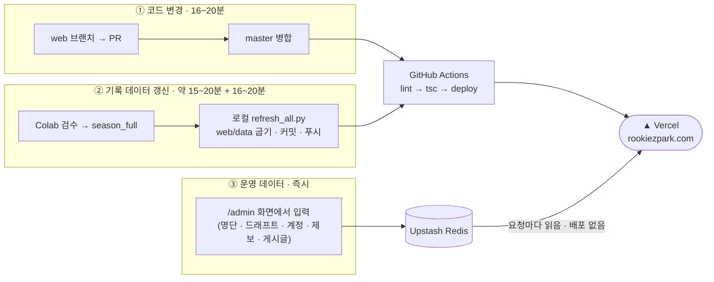

| 길 | 바꾸는 것 | 누가 | 반영 |
| :-- | :-- | :-- | :-- |
| ① 코드 | 화면·기능·API | 웹 개발 | `master` 병합 후 16~20분 |
| ② 기록 데이터 | 경기·선수·랭킹 등 모든 기록 JSON | 파이프라인 담당 **1명** | refresh 약 15~20분 + 배포 16~20분 |
| ③ 운영 데이터 | 올스타·국가대표·해외 입단 명단, 드래프트 지명, 계정, 제보, 커뮤니티 | 관리자 | **저장하는 즉시** |

③은 구운 JSON 위에 Upstash 값을 덮어 보여주는 구조라, Upstash 가 비거나 죽어도 마지막으로 구운
JSON 으로 화면이 뜹니다. 다음 refresh 때 `export_rosters` · `export_draft` 가 Upstash 내용을 JSON
으로 다시 굽습니다.

### 3. 평소 운영 주기

| 언제 | 무엇을 | 어디서 | 담당 |
| :-- | :-- | :-- | :-- |
| 경기가 열린 뒤 | 1번 노트북으로 기록지·박스스코어 크롤 | Colab | 파이프라인 |
| 크롤 직후 | 기록지를 손으로 보정 (작업자 현황 시트로 분배) | Drive · 엑셀 | 기록원 |
| 보정 후 | `run_all_pipeline(2026)` → diff 0 될 때까지 보정과 반복 | Colab | 기록원 |
| diff 0 이 되면 | 4번 노트북으로 `season_full` 마감 (필요하면 5·6번: 수비이닝·일정) | Colab | 파이프라인 |
| 그다음 | `python scripts/refresh_all.py` → 자동 커밋·푸시 → 자동 배포 | 로컬 PC | 파이프라인 |
| 배포 후 | 사이트에서 새 경기·랭킹 확인, 이상하면 `/admin/kbsa-check` 로 공식 기록과 대조 | 브라우저 | 파이프라인 |
| 수시 | 명단 발표되면 `/admin/rosters` 입력, 제보 처리, 커뮤니티 관리 | 사이트 관리 화면 | 관리자 |
| 드래프트 당일 (연 1회) | 입력기로 지명 결과 입력 → 저장소로 전송 | 오프라인 PC | 관리자 |
| 드래프트 후 | `score_predictions.py` 로 예측 채점 → `/admin/draft-score` | 로컬 → 사이트 | 분석 |

### 4. 사람과 권한

사이트 계정은 **4등급**이고, 관리자 안에서 한 번 더 나뉩니다. 자세한 설계는
[web/AUTH.md](https://github.com/Ryong1001/highschool-stats-web/blob/master/AUTH.md).

| 등급 | 들어오는 법 | 볼 수 있는 것 · 할 수 있는 것 |
| :-- | :-- | :-- |
| 비로그인 | — | 공개 시즌(현재 2023~2026, `web/app/lib/seasons.ts` 의 `PUBLIC_SEASONS`)의 모든 기록 |
| 일반 사용자 | 구글 로그인 | + 기록 오류 제보, 커뮤니티 글쓰기 |
| **파트너** (외부) | 아이디·비밀번호 (주 관리자가 발급) | + 비공개 선수·과거 시즌·랭킹 보정열·구장 파크팩터 |
| **관리자** | 아이디·비밀번호 (주 관리자가 발급) | + `/admin` 전체, `/predict`, 데이터 반출 |
| **주 관리자** (1명) | 환경변수 `ADMIN_ID` | + 파트너·관리자 **계정 발급·회수** |

계정을 나눠 주는 권한만 주 관리자에게 두는 이유는, 관리자가 파트너 계정을 직접 만들 수 있으면
목록을 가려 봐야 의미가 없어서입니다. 파트너·관리자 계정은 지우는 즉시 로그인이 풀립니다.

**관리 화면**

| 경로 | 용도 |
| :-- | :-- |
| `/admin` | 제보 처리 · 구글 계정 목록·차단 · 데이터 현황 · 파트너/관리자 계정 (주 관리자만) |
| `/admin/rosters` | 올스타·국가대표·해외 입단 명단 입력 (임시 저장 가능, 직전 20개 이력 보관) |
| `/admin/draft` · `/admin/draft-score` | 드래프트 지명 입력 · 예측 채점 결과 |
| `/admin/constants` | 시즌마다 적합된 상수 (선형가중치·RE24 표) |
| `/admin/seasons` | 공개하지 않은 과거 시즌 열람 |
| `/admin/kbsa-check` | 고친 기록지 vs KBSA 공식 박스스코어 대조 |
| `/admin/tracking` | 아카데미 Rapsodo 트래킹 ↔ 우리 선수·경기 연결 결과. 선수 상세의 'Rapsodo 트래킹'·'U-18 국제대회 투구' 구역도 관리자에게만 (관리자용 매뉴얼 12장) |
| `/board` | 커뮤니티 — 관리자는 글 고정·삭제 |

### 5. 열쇠는 누가 갖고 있나

| 열쇠 | 어디에 | 가진 사람 | 새면 |
| :-- | :-- | :-- | :-- |
| GCP 서비스 계정 키 | `secrets/secrets.toml` (git 제외) | 파이프라인 담당 1명 | Drive 전체 노출 → GCP 콘솔에서 키 폐기·재발급 |
| `VERCEL_TOKEN` 등 3개 | web 저장소 Actions Secrets | 저장소 주인 | 누구나 배포 가능 → Vercel 에서 토큰 폐기 |
| 서버 환경변수 (`SESSION_SECRET`, `ADMIN_ID/PASSWORD`, `GOOGLE_CLIENT_*`, `UPSTASH_*`, `EXPORT_KEY`, `PREDICT_PASSWORD`, `AUTH_ORIGIN`) | Vercel 프로젝트 설정 | 저장소 주인 | 해당 값만 교체 (`SESSION_SECRET` 교체 = 전원 로그아웃) |
| Drive 폴더 공유 | Google Drive | 기록원 각자 | 공유 해제 |

팀원 로컬 개발용 `.env.local` 은 `setup.py` 가 견본으로 만들어 주고, **관리자 아이디·비밀번호는
각자 다른 값**을 씁니다. 실서비스 값은 공유하지 않습니다.

### 6. 문제가 생기면

| 상황 | 대응 |
| :-- | :-- |
| 푸시했는데 사이트가 안 바뀐다 | 먼저 **20분**은 기다립니다. 그래도 그대로면 GitHub → web 저장소 → **Actions** 탭에서 lint·타입 검사에 막혔는지 확인 |
| 잘못된 버전이 배포됐다 | Vercel 대시보드에서 직전 배포로 되돌리기(Instant Rollback) → 그다음 `git revert` 로 코드도 되돌려 푸시 |
| 기록 숫자가 이상하다 | 코드보다 먼저 [데이터 계약과 함정](#-데이터-계약과-함정) · 선수 마스터 품질을 확인 |
| Upstash 가 죽었다 | 사이트는 구운 JSON 으로 계속 뜹니다(fail-open). 명단 입력·로그인 쓰기만 멈춤 |
| 배포 한도에 걸렸다 | Hobby 는 하루 업로드 파일 수 제한이 있어 `--archive=tgz` 로 묶어 올립니다. 짧은 시간에 refresh 를 여러 번 돌리지 마세요 |

---

## 🗺️ 전체 흐름도 (자세히)

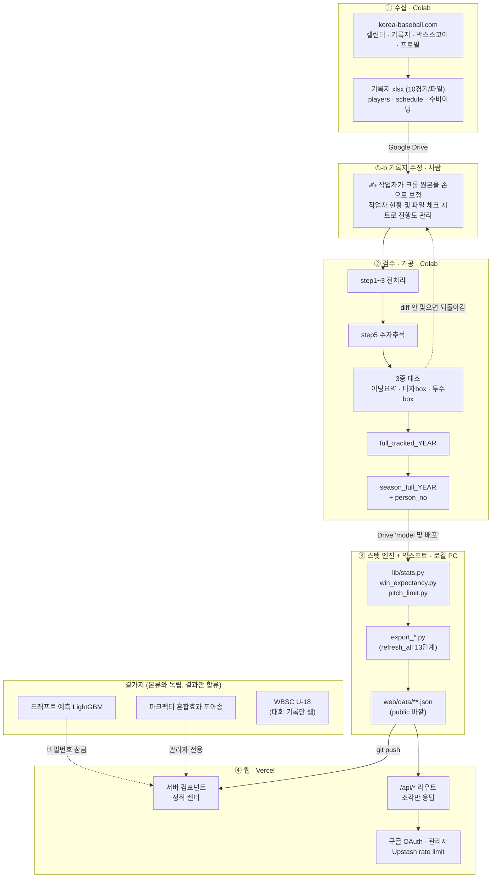

---

## ⚙️ 실행 주체와 위치

| 단계 | 실행 위치 | 실행 방법 | 빈도 |
| :-- | :-- | :-- | :-- |
| ① 수집 | Google Colab | 노트북 셀 실행 | 경기일마다 |
| ①-b **기록지 수정** | 사람 (엑셀) | 작업자가 크롤 원본을 손으로 보정 | 수집 직후 · 검수에서 되돌아올 때마다 |
| ② 검수·가공 | Google Colab *(로컬 미러 병행 가능)* | `run_all_pipeline(2026)` | 기록지 수정 후 |
| ③ 익스포트 | 로컬 PC (Windows) | `python scripts/refresh_all.py` | ② 직후 |
| ④ 배포 | Vercel | ③이 자동 커밋·푸시 | ③에 포함 |

> [!TIP]
> `scripts/pipeline_local.py` 는 ②의 Colab 파이프라인을 그대로 로컬에서 돌리는
> 판본입니다. Drive 마운트 대신 `local_mirror/{YEAR}/` 를 읽습니다.

---

## 📁 저장소 배치

```
졸업작품/
├── *.ipynb                 ① 수집 · ② 검수 노트북 (본류)
├── lib/                    ③ 스탯 엔진 (순수 pandas, 프레임워크 비의존)
├── scripts/                ③ 익스포트 + 오케스트레이션
├── web/                    ④ Next.js 사이트  ⚠ 별도 git 저장소 (.gitignore 로 제외)
├── data/                   국가대표·올스타 등 로컬 원본 xlsx
├── 모델/                    드래프트 예측 · 타자/투수 모델링 노트북
├── 분석/                    파크팩터 · 주루(BsR) · oWAR · dFIP 등 분석 스크립트
├── 카드/                    인스타 카드 굽는 스크립트 + 에셋 (PNG 결과는 git 제외)
├── local_mirror/           Drive 원본의 로컬 사본 (git 제외)
└── wbsc/                   WBSC 크롤 결과 (git 제외)
```

---

# 세부 구조

## 계층 0 — 데이터 원천

| 원천 | 내용 | 접근 |
| :-- | :-- | :-- |
| `korea-baseball.com` (KBSA) | 캘린더 / record_detail(기록지) / box_score / player_view | HTTP 크롤 |
| Google Drive | 모든 원본·중간 산출물의 보관소 | Colab 마운트 + 서비스 계정 |
| Upstash Redis | 올스타·국가대표·해외 입단 명단, 드래프트 지명자 — 관리 화면에서 넣는다 | REST |
| 중계 영상 (mp4) | 구속·로케이션 판독 원본 | 로컬, 저장소 밖 |
| WBSC 사이트 | U-18 월드컵 PBP·공식 박스스코어 | HTTP 크롤 |

<details>
<summary><b>Drive 접근이 두 갈래인 이유</b></summary>

<br>

Colab 노트북은 `drive.mount` 로 사용자 계정을 씁니다. 반면 `scripts/*.py` 는 로컬 PC에서
돌아야 하므로 `secrets/secrets.toml` 의 **GCP 서비스 계정**으로 Drive API(`drive.readonly`)를
직접 칩니다. 후자가 `_drive_common.py` 입니다.

</details>

---

## 계층 1 — 수집 (크롤링 노트북)

| 노트북 | 하는 일 | 산출물 |
| :-- | :-- | :-- |
| `1. KBSA_크롤링_(당해년도_버전)_.ipynb` | 캘린더에서 날짜별 game_id 수집 → 기록지 파싱. 같은 루프에서 `box_score` 도 받아 **league·stadium 을 크롤 시점에 채움** | `{YYYY}_{MM}_{a~z}.xlsx`, `batter_box`, `pitcher_box`, `inning_summary` |
| `5. 수비이닝 크롤링.ipynb` | season_full 의 새 game_id 출전 선수만 `gubun=P` 재크롤 → 이전 누적과 아웃 단위 차분 | `defense_innings_{YEAR}.xlsx`, `player_defense_{YEAR}.xlsx` |
| `6. 경기 일정 크롤링.ipynb` | 아직 안 열린(점수 없는) 경기 + 취소 경기 수집. **일시정지(서스펜디드) 경기**는 중단 시점 스코어보드까지 같이 받아둔다 | `schedule_{YEAR}.xlsx`, `score_box_{YEAR}.xlsx` |
| `출신 크롤링.ipynb` | `player_view` 프로필 → 출신교·등번호·포지션·투타 | `players_{YEAR}.xlsx` |
| `특수경기결과 크롤링.ipynb` | 몰수경기·추첨승 등 **타석이 없어 기록지가 없는 경기**. 일시정지 경기는 재개되면 기록지가 생기므로 여기에 넣지 않는다 | `special_games_{YEAR}.xlsx` |
| `리그전 가져오기.ipynb` | league/stadium 사후 보정 *(2026-08-10부터 보정 전용)* | 기존 파일 갱신 |

<details>
<summary><b>수집 단계의 설계 포인트 4가지</b></summary>

<br>

- **파일 분할 규칙** — 경기 10개마다 `2026_08_a.xlsx`, `..._b.xlsx` 식으로 끊습니다.
  한 파일이 커지면 검수 때 재작업 단위가 통째로 커지기 때문입니다.
- **Colab DNS 우회** — Colab 런타임의 리졸버가 KBSA 호스트를 못 풀 때가 있어, 공용 DoH 로
  A레코드를 받아 `getaddrinfo` 에 심습니다 *(SNI·인증서 검증은 유지)*.
- **작업자 현황 시트 연동** — 수집된 파일 목록을 Google Sheets "파일 체크" 시트에 자동
  반영해 사람이 검수 진행도를 봅니다.
- **등번호 센티넬** — `0`=미확인 / `100`=번호 없음(확인 완료) / `1~99`=실번호.
  고교야구엔 3자리 번호가 없어 100이 안전한 표식입니다. 홈페이지는 0·100 둘 다 `-`.

</details>

<details>
<summary><b>곁가지 — WBSC 라인</b></summary>

<br>

`WBSC 크롤링.ipynb` 이 `props.viewData.original.gamePlays` 를 파싱해 KBSA 포맷 PBP로 바꾸고,
`WBSC 검수.ipynb` 이 그것을 **공식 boxScore와** 대조합니다(sim값 vs 실제값).
원본 `id` 필드는 stale 해서 `lineupslot` 만 신뢰합니다. 웹에는 `run_wbsc.py` → `export_national_team_games/stats` 로
U-18 대회 기록(`national_team_stats.json`)과 2026 경기 상세(`national_team_games/`)만 들어가 있습니다.

</details>

---

## 계층 2 — 검수 · 가공

**입력은 크롤 원본이 아니라 사람이 손본 기록지입니다.** 크롤러가 받아온 xlsx 를 작업자가
먼저 보정하고, 그 결과를 이 검수가 받습니다. 핵심은
`2-3. 통합 체크 (아웃·점수 + 주자상황).ipynb` 하나이고, 맨 아래 셀의
**`run_all_pipeline(2026)` 만 실행하면 끝납니다.**

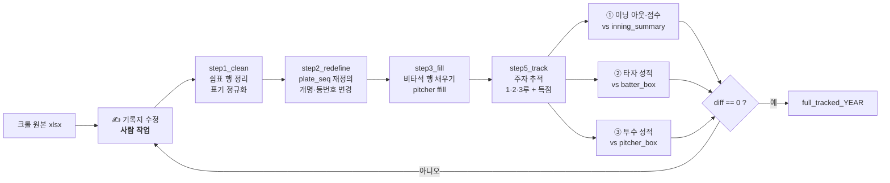

> [!NOTE]
> **기록지 수정은 검수 실패 시에만 하는 게 아닙니다.** 크롤링 직후 한 번은 반드시 거치는
> 정규 단계이고, 검수에서 diff 가 남으면 같은 자리로 되돌아옵니다.

### 산출 파일 6종

| 파일 | 내용 |
| :-- | :-- |
| `{YEAR}_enter_inning_summary.xlsx` | 재현한 이닝별 아웃·점수 |
| `{YEAR}_diff_inning_summary.xlsx` | 위와 원본 `inning_summary` 의 차이 |
| `{YEAR}_issues.xlsx` | 전처리·요약·대조 이슈 |
| `{YEAR}_tracking_issues.xlsx` | 주자추적 이슈 |
| `{YEAR}_batter_diff.xlsx` · `{YEAR}_pitcher_diff.xlsx` | 박스스코어 대조 |
| `season_full/full_tracked_{YEAR}.xlsx(.parquet)` | **주자추적이 끝난 시즌 통합 PBP** |

> [!NOTE]
> diff 파일이 전부 0이 될 때까지 사람이 기록지를 고치고 다시 돌리는 것이 검수 루프입니다.
> `부정위_타순.xlsx` 처럼 규칙으로 못 푸는 예외는 표로 따로 넣어 `step5_track` 이 읽습니다.

> [!WARNING]
> **3벌 동기화 문제** — 같은 전처리 코드가 세 곳(통합본 / 2번 / 3번 노트북)에 복사돼
> 있습니다. 갈라져도 **에러가 안 나고 결과만 조용히 틀리기** 때문에,
> `검수 코드 동기화 검사.ipynb` 가 `step1_clean`·`step2_redefine`·`step3_fill`·`_is_batting`·
> 판정 상수를 대조합니다. 실제로 `_is_batting` 의 `루공과` 처리가 갈라져 있던 것을 이걸로 잡았습니다.

<details>
<summary><b>season_full 마감 — <code>4. 스트림릿 제조.ipynb</code></b></summary>

<br>

`full_tracked` 를 웹이 쓸 최종 형태로 마감합니다.

1. **`special_games_{YEAR}.xlsx` 병합** — 몰수경기 등 *결과 전용 행*을 채웁니다.
   선수 집계엔 안 잡히고 순위표·일정처럼 game_id 단위로 보는 곳에만 반영됩니다.
2. `batter`/`pitcher` 의 `"이름(등번호)"` 표기를 이름·번호로 분리.
3. `pitcher` 를 `(game_id, def_team)` 기준 **ffill** — 원본은 등판 시작 행에만 값이 있습니다.
4. `players_{YEAR}.xlsx` 와 매칭해 **`batter_person_no` / `pitcher_person_no`** 부여.
5. `season_full_{YEAR}.xlsx` **+ `.parquet`** 저장 *(8만 행 기준 11초 → 0.5초)*.

</details>

---

## 계층 3 — 스탯 엔진 (`lib/`)

Streamlit 앱을 걷어낸 뒤에도 살아남은 **순수 pandas 모듈**입니다. 프레임워크 의존이 없어
노트북·스크립트 어디서든 그대로 씁니다.

### `lib/stats.py`

`season_full` 한 장을 입력으로 받아 거의 모든 지표를 만듭니다.

```python
# 입력 컬럼 계약
game_id, inning, topbot, team, def_team, batter, pitcher, order,
result, on_base_123, outs_when_up, plate_seq,
base_1_run, base_2_run, base_3_run, scored_run,
away_score, home_score, RBI,
tournament, round, stadium, date, month,
batter_person_no, pitcher_person_no
```

| 영역 | 함수 | 비고 |
| :-- | :-- | :-- |
| 결과 문자열 해석 | `_clean` `_is_ab` `_is_hit` `_hit_bases` `_is_sac_fly` `_is_strikeout` `_is_gdp` `_is_reached_on_error` | 한글 결과 코드(`유땅`·`중희플출R`·`낫아웃+송구실책`…)를 규칙으로 해석 |
| 타구 유형 | `batted_ball_zone` `batted_ball_type` `batted_ball_profile` `batted_ball_locations` | GO/AO 는 **아웃만** 세는 정의 |
| 기본 집계 | `batting_totals` `_runs_scored` | |
| wOBA / wRC+ | `compute_woba_weights` `add_woba` `add_wrc` | 선형가중치를 **이 리그 RE24로 직접 추정** (MLB 상수 미사용) |
| 투구 | `pitching_totals` `build_pitching_table` `add_fip` `league_fip_constant` | IP·ER·HR·BB_HBP·K 는 공식 박스스코어 값 그대로 |
| RE24 | `_play_events` `build_re24_table` `compute_re24` | 24상태 기대득점 (상태 전이로 푸는 마르코프, 승부치기는 `lib/re24_extra.json`) |
| 도루 | `steal_events` `steal_totals` | `order` 자릿수 파싱 (더블스틸 `92`=9번+2번) |

<details>
<summary><b><code>lib/win_expectancy.py</code> — 승리확률 · WPA · LI</b></summary>

<br>

경험적 24상태 테이블은 **고교 1시즌 표본에서 편향이 커서**(동점인데 홈 0.73 등) 정규근사
모델로 대체했습니다.

```
P(홈 승) = Φ( (d + E_home_rest − E_away_rest) / sqrt( σ²_half × (남은 반이닝 + 1) ) )
```

- 루상황 보정만 이 리그 RE로 넣고, `μ_half`(≈0.72)·`σ²_half`(≈2.20)는 그 시즌에서 캘리브레이션
- 동점·대칭 → **정의상 0.5 보장**
- **WPA**: 공격팀 관점 ΔWE. 타자 `+`, 투수 `−`. 시즌 합은 제로섬
- **LI**: 그 상태의 평균 `|ΔWE|` ÷ 리그 평균 (리그 평균 = 1.0)

</details>

<details>
<summary><b><code>lib/pitch_limit.py</code> — KBSA 투구수 제한 규정</b></summary>

<br>

하루 최대 105구, 구간별 의무 휴식일(46~60구 1일 / 61~75구 2일 / 76~90구 3일 / 91~105구 4일),
더블헤더 합산, 3일 연속 투구 금지를 코드로 옮긴 것입니다.

</details>

---

## 계층 4 — 익스포트 (`scripts/`)

### 오케스트레이터 — `refresh_all.py`

```bash
python scripts/refresh_all.py                    # 2026 전체 → 커밋 → 푸시
python scripts/refresh_all.py --no-push          # 커밋만
python scripts/refresh_all.py --no-commit        # JSON만 다시 굽기
python scripts/refresh_all.py --only advanced,rankings
```

- export 들은 **원칙적으로 서로 독립**입니다. 다만 각자 Drive에서 같은 파일을 받으므로
  실행 단위 다운로드 캐시(`EXPORT_CACHE_DIR`)로 중복 다운로드를 없앱니다.
- **순서 의존은 한 곳**입니다 → `rosters → players`
- 실행 전에 커밋 author 를 검사합니다. 배포가 GitHub Actions(소유자 토큰)로 바뀐 뒤로는
  다른 계정으로 커밋해도 배포되므로, 팀원은 `--allow-any-author` 로 통과시키면 됩니다.
- 푸시는 현재 체크아웃된 브랜치로 → `master`=실서비스, `preview`=프리뷰

### 실행 순서

| # | 스크립트 | 산출물 | 시간 | 메모 |
| :-- | :-- | :-- | --: | :-- |
| 1 | `export_rankings` | `rankings_2026{,_d7,_d14,_d30}.json` | 1분 38초 | PA 하한·상위 N 자르기 없이 전원 (필터는 프론트) |
| 2 | `export_standings` | `standings_2026.json`, `..._by_tournament.json` | 21초 | 대회별이어도 wRC+·FIP 기준선은 **시즌 전체 고정** |
| 3 | `export_teams` | `teams/{team}.json`, `teams_index.json` | 49초 | 팀별 분할 |
| 4 | `export_games` | `games_2026.json` | 32초 | 경기 찾기 + 이닝별 스코어보드 |
| 5 | `export_rosters` | `allstar.json`, `national_team.json`, `foreign_signing.json`, `rosters_all.json` | 5초 | 원본은 **저장소**(Upstash). ⚠️ **players 보다 먼저** |
| 6 | `export_players` | `players/{person_no}.json`, `players_index.json` | 🐢 **9분 24초** | 전체의 절반. 워커 12개로 나눠도 가장 오래 걸린다 |
| 7 | `export_career` | `career_2026.json` | (평소 건너뜀) | **과거 시즌** 선수 파일만 모은다. 현재 시즌만 굽는 평소 실행에선 결과가 같아 건너뛰고, `--past-seasons` 나 `--only career` 일 때만 돈다 |
| 8 | `export_clutch` | `clutch_2026.json` | 5초 | 득점권 RE24 |
| 9 | `export_pitch_watch` | `pitch_watch_2026.json` | 2초 | 기준일 고정 스냅샷 (KST 오늘) |
| 10 | `export_draft` | `draft.json` | 24초 | 엑셀(역대) + **저장소**(프로그램으로 넣은 해)를 합쳐 굽는다 |
| 11 | `export_game_detail` | `games/{game_id}.json` | 1분 26초 | 이닝별 중계·득점 모아보기·투구수 |
| 12 | `export_advanced` | `winprob/{id}.json`, `leverage_*.json`, `matchups_*.json.gz` | 32초 | WPA/LI/상대전적(1타석 이상 전부) |
| 13 | `export_predictions` | `app/predict/_data/predictions.json` | 약 2분 44초 | LightGBM 학습 포함 |

**전체 약 15분 30초**(예측 제외, 2026-10-06 실측 — 다른 작업과 CPU 를 나눠 쓰며 잰 값이라 혼자 돌리면 더 짧을 수
있습니다). 같은 날 같은 입력으로 고치기 전에 잰 값은 18분 51초였고, 2026-09-21 에는 30분이었습니다. 줄어든 이유는
둘입니다: 엑셀 해석 결과를 실행 캐시에 남겨 batter_box·pitcher_box 를 수십 번 다시 해석하지 않게 했고(`_drive_common.load_by_name`),
과거 시즌 파일만 읽는 `export_career` 를 평소에는 건너뜁니다.

**`players` 가 여전히 전체의 60%** 입니다. 한 단계만 고칠 일이라면 `--only` 로 그것만
굽는 쪽이 현실적입니다(예: 드래프트만 다시 → `--only draft`, 24초). 예측(`predictions`)은 드래프트 결과가
들어온 뒤에는 다음 학년으로 넘어가 `/predict` 와 동결본을 바꾸니, 데이터만 다시 구울 땐 `--only` 로 빼세요.

**refresh_all 밖 (수동 실행)**

- `export_park_factors.py` — full_tracked 7시즌(≈70MB) 다운로드 + 혼합효과 적합이 무겁고
  과거 시즌이 고정이라 매번 돌릴 이유가 없습니다. `statsmodels` 필요.
- `export_constants.py` — 시즌마다 적합된 상수(선형가중치·RE24 표·도루 상수)를 `constants_{year}.json`
  으로. 관리자 화면 `/admin/constants` 가 읽습니다. 스탯 엔진을 고친 뒤에 돌립니다.
- `build_re24_extra.py` — 승부치기 전용 RE 표(`lib/re24_extra.json`)를 7시즌 초 공격으로 다시 만듭니다.
- `export_og_image.py` — 링크 미리보기 썸네일 한 장(`web/app/opengraph-image.png`).
- `crawl_team_info.py` — KBSA 팀정보(지역·창단년도·감독·주소)를 긁어 `team_info.json` 생성.
  club_idx 104개를 목록에서 모아 팀마다 한 번씩 두드리므로, 새 팀이 생겼을 때만 돌립니다.
- `run_wbsc.py` → `export_national_team_games.py` · `export_national_team_stats.py` — U-18 국가대표
  경기 상세(`national_team_games/`)와 대회 기록(`national_team_stats.json`). 국제대회가 끝났을 때.
- `export_romanization.py` — 영문판 이름 로마자 표(`romanization.json`). 명단이 늘었을 때.
- `score_predictions.py --save` / `score_posthoc.py --save` — 드래프트 결과가 들어온 뒤 예측 채점.
- `export_draft.py` — 드래프트만 다시 굽기(계약금 CSV·정정표 반영). `refresh_all` 에도 들어 있다.

<details>
<summary><b>공용 헬퍼 모듈</b></summary>

<br>

| 모듈 | 역할 |
| :-- | :-- |
| `_drive_common.py` | 서비스 계정 인증, 이름으로 Drive 파일 해석·다운로드, 팀명 정규화, 포지션 파생, 아웃↔이닝 변환 |
| `_roster_match.py` | 명단 ↔ 선수 마스터 매칭(성명·학교·학년·포지션), 같은 팀 동명이인 가르기 |
| `_team_names.py` | 팀명 표기 통일 |
| `_park_common.py` | 구장명 정리, 파크팩터 로드 |
| `_we_shared.py` | `export_advanced` / `export_game_detail` 이 공유하는 WE 준비 로직 |
| `_parallel.py` · `_progress.py` | 병렬 실행, 한 줄 진행률 (cp949 콘솔 폴백 포함) |
| `_kv.py` | Upstash Redis REST 래퍼 — 웹(`lib/kv.ts`)과 같은 저장소를 파이썬에서도 본다 |
| `pull_from_vercel.py` · `rename_team.py` · `import_rosters_to_kv.py` | 운영 보조 |

**소비하는 Drive 원본**
`season_full_{year}` · `players_{year}` · `batter_box_{year}` · `pitcher_box_{year}` ·
`schedule_{year}` · `full_tracked_{y}` · `batter_stats_all_v2` · `pitcher_stats_all_v2` ·
`KBO 신인드래프트 지명자`

(올스타·국가대표·해외 입단 엑셀은 **더 이상 원본이 아닙니다** — 저장소로 옮겼습니다. 아래 참고.)

드래프트는 둘을 다 봅니다. 지난 해들은 엑셀에 적혀 있고, 그 해 드래프트는 당일 입력
프로그램으로 넣어 저장소에 쌓입니다 — `export_draft` 가 합쳐 굽고 저장소 쪽이 이깁니다.
엑셀에만 기대던 동안에는 프로그램으로 넣은 해가 `draft.json` 에 없어서, 그 파일만 보는
예측 채점(`score_predictions.py`)이 "결과가 아직 없다"며 멈췄습니다.

</details>

> [!CAUTION]
> **Drive 동명 파일 함정** — `_resolve()` 는 예전에 동명 파일 중 검색 결과 첫 번째를 말없이
> 집었습니다. Drive는 순서를 보장하지 않아 실행할 때마다 다른 파일을 읽을 수 있었고, 실제로
> `schedule_2026.xlsx` 가 서로 다른 기간의 경기를 담은 두 파일로 존재해 **38경기가 조용히
> 누락**된 적이 있습니다(2026-07-21). 지금은 경고를 찍고 `modifiedTime` 최신본을 고릅니다.

---

## 계층 5 — 웹 (`web/`)

`Next.js 16.2` · `React 19` · `Tailwind 4` · `TypeScript` · Vercel 배포 · **별도 git 저장소**

### 데이터 접근 구조 — 크롤링 방지가 설계 목적

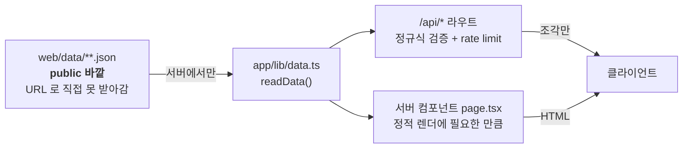

- 예전엔 `public/data` 였지만, 그러면 `/data/rankings_2026.json` 으로 **통짜 색인이 유출**됩니다.
- Vercel 서버리스는 런타임 동적 경로 파일을 번들에 안 넣어 ENOENT 가 나므로,
  `next.config.ts` 의 `outputFileTracingIncludes` 로 **라우트별 필요한 폴더만** 콕 집어 포함합니다.
- 모든 API 라우트는 **입력 정규식 검증**(경로 탈출 차단) + **rate limit** 을 겁니다.
  예) `personNo` → `^\d+$` · `period` → `^(_d\d{1,3})?$`

<details>
<summary><b>rate limit — fail-open 원칙</b></summary>

<br>

- Upstash 미설정·오류 시 **요청을 통과시킵니다**. 보호 장치가 사이트 자체를 죽이는 게 최악이라서.
- env(`UPSTASH_REDIS_REST_URL`/`_TOKEN`)가 있으면 IP별 고정창 카운터로 진짜 차단.
- 없으면 인스턴스 로컬 메모리 폴백 *(서버리스라 인스턴스마다 따로 논다 — 임시 방어일 뿐)*.

</details>

### 인증 — 4등급

| 등급 | 되는 것 |
| :-- | :-- |
| 🔓 **guest** | 공개 시즌 기록 열람 — 로그인을 강제하는 페이지 없음 |
| 👤 **user** (구글 OAuth) | 기록 오류 제보, 커뮤니티 글쓰기, 즐겨찾기 서버 저장 |
| 🤝 **partner** (ID/PW, 계정 표) | 비공개 선수·과거 시즌, 랭킹 보정열, `/parks` |
| 🔑 **admin** (ID/PW) | 위 전부 + `/admin`, `/predict`, 반출. 계정 발급은 **주 관리자(`ADMIN_ID`)만** |

<details>
<summary><b>인증 설계에서 일부러 그렇게 한 것들</b></summary>

<br>

- **세션은 서명 쿠키 하나**(`rp_session`). 대부분 페이지가 정적 JSON을 읽으므로 요청마다
  Redis를 왕복할 이유가 없습니다. 쿠키엔 식별자·등급·표시 이름만 *(서명일 뿐 암호화 아님)*.
- **로그인 상태는 클라이언트가 `/api/auth/me` 로 물어봅니다.** layout 에서 쿠키를 읽으면
  사이트 전체가 동적 렌더링이 됩니다 — 기록 페이지를 정적으로 남기는 쪽이 훨씬 중요합니다.
  화면 표시는 표시일 뿐이고, **실제 권한은 각 페이지·API가 서버에서 다시 확인**합니다.
- **관리자 비밀번호를 바꾸면** 서명 키에 섞여 있어 발급된 관리자 세션이 자동 무효화됩니다.
  전원 로그아웃은 `SESSION_SECRET` 교체.

</details>

### 라우트 지도

| 경로 | 데이터 | 노출 |
| :-- | :-- | :-- |
| `/` | 홈 `SECTIONS` | 전체 |
| `/rankings` | `rankings_2026{,_d7,_d14,_d30}.json` | 전체 *(`wRC+_adj` 는 관리자만)* |
| `/compare` | players API | 전체 |
| `/standings` | `standings_2026*.json` | 전체 |
| `/clutch` | `clutch_2026.json` + `leverage_2026.json` | 전체 |
| `/team` | `teams_index.json` → `teams/{team}.json` (+ `team_info.json`) | 전체 |
| `/depth-chart` | `teams_index.json` + `players_index.json` | 전체 |
| `/games` | `games_2026.json` → `games/{id}.json` + `winprob/` | 전체 |
| `/pitch-watch` | `pitch_watch_2026.json` | 전체 |
| `/national-team` `/allstar` `/foreign-signing` | 각 JSON | 전체 |
| `/search` | `players_index.json` *(초성 검색)* | 전체 |
| `/board` | Upstash (글·이미지) | 읽기 전체 · 쓰기 로그인 |
| `/report` · `/account` | 제보 폼 · 계정 | 로그인 |
| `/parks` | `park_factors.json` | 🤝 파트너·🔑 관리자 **+ 파일이 있을 때만** |
| `/predict` | `app/predict/_data/predictions.json` | 🔑 관리자 또는 비밀번호 |
| `/admin/**` | 제보·계정·명단·드래프트·상수·과거 시즌·KBSA 대조 | 🔑 관리자 |

> [!IMPORTANT]
> **새 탭을 추가할 때는 `TopNav` 의 `NAV_ITEMS` 와 홈 `page.tsx` 의 `SECTIONS` 둘 다에
> 등록해야 노출됩니다.** `/predict`·`/parks`·`/team` 은 의도적 예외입니다.

<details>
<summary><b>주요 컴포넌트</b></summary>

<br>

`RankingTable`(정렬·필터·규정타석) · `GameDetailView`(이닝별 중계) · `WinProbChart` ·
`LeverageView` · `MatchupSection` · `SprayChart`/`SprayTendency`(타구 위치) ·
`BattedBallSplit` · `PercentileBars` · `MonthlyTrendChart` · `DepthChartView` ·
`ShareCard` · `SearchModal` · `StatInfo`(용어사전)

</details>

---

## 🧩 곁가지 파이프라인

### 🎯 드래프트 예측 모델

LightGBM 이진분류. 노트북(`드래프트 예측 모델1.ipynb`)을 Colab 비의존으로 이식한 것이
`export_predictions.py` 이고 `refresh_all` 안에서 함께 돕니다.

- **학습 코호트**: 손으로 적지 않습니다. `pick_train_cohorts` 가 "3학년 성적이 있고 드래프트
  결과도 있는 해"를 원본에서 골라냅니다 — 2026 예측 기준 2020~2025. 검수 끝난 시즌이 성적
  원본에 들어오면 다음 실행부터 아무것도 안 고쳐도 학습에 합류합니다.
- **레이블**: 드래프트 원본에서 매번 새로 생성(중간 파일 불신). 고졸 지명 = 드래프트 당시
  소속이 실제 고교 리그에서 뛴 팀인 경우 — 팀명 규칙이 아니라 **명단/기록 존재로 판정**
  (용인시야구단·아산BC 같은 U-18 클럽도 대상이므로)
- **입력**: 전부 **코호트 내 백분위**. `MIN_PA=50`, 표본 축소 `K_PA=100` / `K_IP=30`
  *(U-18 국가대표는 이 최소 표본을 면제 — 아래 경고 참고)*
  - 타자 25개 — 비율 11개 + 기회량 + **이전 학년(고1·고2) 누적** 13개
  - 투수 14개 — 비율 10개 + 기회량 + **상대 수준 환경** 2개(상대타자수준·전국대회비율) + **K%oe**(상대 타자·구장을
    보정한 삼진율, 2026-10-04 추가)
- **환경 피처는 투수에만** 넣습니다. "같은 FIP 라도 누구를 상대해 만든 것이냐"를 알려주는
  건데, 보정된 성적(dFIP)이 아니라 **환경만** 넣습니다 — 성적은 이미 모델에 있으니 겹치지
  않는 쪽이 정보가 됩니다. 2026-09-18 측정(시드 5개 평균, 페어드 부트스트랩 2000회):

  | 투수 | AUROC | 차이 | 95% CI | P@50 |
  | :-- | --: | --: | :-- | --: |
  | 기존 | 0.8500 | | | 40 |
  | +dFIP | 0.8555 | +0.0055 | [−0.0007, +0.0111] | 44 |
  | +상대수준 | 0.8823 | +0.0324 | [+0.0204, +0.0449] | 48 |
  | **+상대수준+전국대회비율** | **0.8930** | **+0.0430** | [+0.0289, +0.0566] | 48 |

  dFIP 를 그대로 넣는 건 CI 가 0 을 포함해 무효였습니다. 효과가 있던 `dFIP−FIP` 는 정의상
  −SLOPE_FIP×(상대 타자 z_wOBA 평균)이라 보정 성적이 아니라 상대 수준 그 자체라, 상대
  수준을 직접 넣는 쪽이 낫습니다. **전국대회비율을 같이 넣는 이유**는 상대 수준이 실력이
  아니라 '전국대회를 많이 뛴 강팀 선수'라는 노출 대리변수일 수 있어서입니다 — 둘을 같이
  놔야 상대 수준이 그 몫을 넘어 기여하는지가 갈립니다.
  **타자에는 넣지 않습니다** — 어느 조합도 CI 가 0 을 포함했습니다(dwOBA +0.0004, 상대수준
  −0.0009, 전국대회비율 +0.0002). 이전 학년 피처를 투수에 넣지 않은 것과 같은 기준입니다.
- **미리 굽는 이유**: 입력이 코호트 내 백분위라 선수 한 명만 따로 채점하는 게 불가능합니다
  (490명 전체를 다시 순위 매겨야 한 명의 값이 나옵니다). 성적 갱신 시점 = 예측 갱신 시점.
- **출력 위치가 특이한 이유**: `web/data` 도 아닌 `web/app/predict/_data/` 입니다.
  실명 고3 선수의 지명 확률이라 서버 번들에만 포함되고 클라이언트로 안 나가야 합니다.

> [!WARNING]
> **U-18 국가대표 가산은 학습 뒤 로그오즈에 더하는 사후 가산이고, 크기는 과거 결과로 맞춥니다.**
> 처음(2026-09-18)에는 명단이 예측 연도뿐이라 사람이 +1.0 으로 정했습니다. 2027 드래프트
> 채점(09-21)에서 가산 후 AUROC 0.8672 / 가산 전 0.8619 로 도움은 됐지만, 대상 16명 중 15명이
> 지명됐는데 말한 확률은 평균 69.5% 라 **가산이 작았습니다.**
>
> 이후 명단이 저장소(`web/app/lib/rosters.ts`)로 옮겨지며 2022~2025 가 채워졌습니다. 그래서
> 2026-10-27 부터는 `fit_national_bonus` 가 **학습 코호트의 OOF 확률(보정 뒤)에서 국가대표만 골라**
> 가산치 β 를 최대우도로 맞춥니다. 예측 코호트는 쓰지 않으므로 시험 문제를 보고 답을 고치는
> 일이 아닙니다(그 무렵 실측 β ≈ 2.6, 타자·투수 거의 같음). 다만 피처로 학습하는 방식(A)과
> 이 방식(B) 중 B 를 고를 때는 2027 결과를 봤습니다 — A 는 대표를 평균 73% 로 봐(실제 100%)
> 과소평가가 남았고, B 는 AUROC 가 같으면서 상위 10·30 적중이 10/10·21/30 으로 더 높았습니다.
> 깨끗한 검증은 2028 드래프트입니다. JSON 에는 `nationalTeam`·`probBase`(가산 전 확률)와
> 역할별 `metrics.nationalBonus` 를 같이 실어 화면에 드러냅니다.

- **국가대표는 최소 표본도 면제합니다.** 차출 자체가 "기회가 적었어도 주목받는 선수"라는
  신호라, 타석이 모자라다고 순위에서 통째로 지우면 오히려 사실과 멀어집니다(2026 대표 중
  PA 47 / IP 6.7 인 선수가 있었다). 면제는 **예측 코호트에만, 그리고 대표팀에서 맡은 역할 쪽에만** 줍니다 —
  학습 표본의 품질 기준을 낮추면 모델이 흔들리고, 역할을 안 가리면 투수가 타석 두 개로
  타자 모델에 얹혀 '투타겸업'으로 둔갑합니다(윤예성 PA 2). 면제로 들어온 선수는 표본이
  적은 만큼 축소가 리그 평균 쪽으로 강하게 당겨서 모델 확률이 낮게 잡히고(위 선수 4.19%),
  그 위에 가산이 얹힙니다(→ 10.62%).

> [!CAUTION]
> `import lightgbm` 은 **반드시 `pandas` 보다 먼저** 해야 합니다. pandas→pyarrow 가 번들
> `msvcp140.dll` 을 먼저 물어서, 순서가 바뀌면 학습 첫 호출에서 access violation 으로 죽습니다.

### 🏃 주루 (BsR) 와 수비를 뺀 승리기여 (oWAR)

`분석/주루.py` → `분석/war.py`. 스탯티즈가 도루만 세는 팬그래프와 달리 **주루사·견제사·
타구 시 추가 진루까지** 세는 것과 같은 범위를 잡되, **값은 우리 리그 RE24 에서 뽑습니다**
(2026 도루 성공 +0.169, 손익분기 75%. 2026-10-02 RE24 를 마르코프로 다시 풀기 전에는
+0.269 / 65% 로 부어 있었습니다 — [전환 메모](RE24_마르코프_전환_20261002.md)).

- **`base_1_run` 은 불리언이 아니라 주자의 타순 번호입니다.** 이 저장소에서 자주 오해되는
  지점이고, 덕분에 주자를 개별 추적할 수 있습니다. 한 경기 한 타순에 선수가 둘 이상 서는
  경우가 14.8%(대타·대주자)라 타순이 아니라 **사람**으로 이어 붙입니다.
- **기회는 판단이 개입하는 자리만** 셉니다. 땅볼 아웃까지 넣으면 기회가 34,000건으로 부푸는데,
  그때 한 베이스 더 가느냐는 주력보다 타구 방향이 정합니다.
- **도루는 성공·실패를 한 시도로 묶습니다.** 가르면 "성공한 것들끼리의 평균"이 기준이 되어
  도루 성공의 가치가 0 으로 사라집니다.

> [!CAUTION]
> **주루 성분만 떼어 "이 선수는 주루가 좋다"고 읽으면 안 됩니다.** 홀/짝 경기 분할과
> 시즌 간 상관 모두에서, 같은 표본의 타격(K% +0.41~0.48 / wOBA +0.24)과 달리 다시
> 나타나지 않습니다 — 1→3루율 +0.06, BsR/기회 +0.02~0.09, 도루 성공률은 시즌을 건너
> **−0.035**. 기회 정의를 좁히거나 고1~고3 으로 누적해도 오르지 않았습니다.
> **단 하나, 도루 시도율만 +0.549(시즌) / +0.647(커리어)로 K% 보다도 높습니다** — 시즌을
> 건너 되풀이되는 것은 "얼마나 뛰는가" 지 "뛰면 성공하는가" 가 아닙니다.
>
> ⚠ **재현성은 '내년에도 그럴까'를 재는 것이지 '발이 빠른가'를 재는 것이 아닙니다.** 주력의
> 독립 증거(내야안타 비율·3루타)와 대조하면 시도율도 성공률도 상관이 0 근처입니다(시도 10회
> 이상 표본, 2024~2026). 잣대가 흔들리는 값이라 시험의 힘이 약하지만, 어느 쪽이든 "이 값이
> 주력을 잰다"고 할 근거는 없습니다.

화면에는 **SB · CS · SB% · 도루시도%** 를 한자리에 둡니다. 성공률을 실을 수 있는 조건이
**분모가 같은 줄에 보이는 것**이라서입니다 — 규정 통과자의 도루 시도 중앙값이 5회뿐이라 한
번 차이로 20%p 가 움직이는데, 옆에 "1/1" 이 서 있으면 그 50% 를 실력으로 읽지 않습니다.

팀 단위로는 `/standings` 의 타격 탭에 **번트·번트% · 도루시도% · SB%** 가 섭니다. 분모는
주자가 있는 타석(번트)과 1·2루에 주자가 있는 타석(도루)이라, "기회가 많은 팀" 과 "기회를
쓰는 팀" 이 섞이지 않습니다. 2026 리그 전체로 번트 6.3%, 도루 시도 16.2% 입니다.

`oWAR = (wRAA + BsR − 대체수준) / RPW` 는 **능력이 아니라 기여 기록**입니다. 이 시즌에 실제로
얼마를 만들었는지를 적는 것이라, 재현성과 무관하게 BsR 을 그대로(축소 없이) 넣습니다.

- **대체 수준은 리그 안에서 관측합니다** — 스탯티즈 .154 / kWAR .285 처럼 기관마다 두 배씩
  다른 임의의 승률을 고르는 대신, **리그 평균 −0.8σ**(규정타석 이상 선수들의 wOBA 산포)를
  씁니다. 처음엔 '규정타석 미달 선수들의 실제 평균'을 썼는데 타석 15개짜리들의 평균이라
  시즌마다 흔들렸습니다(600타석 −27.2→−43.2, 팀당 oWAR 3.23~4.68). σ 기준으로 바꾸니
  **수준은 그대로(7시즌 평균 3.81→3.83승) 흔들림만 1/4로**(변동폭 1.45→0.36) 줄어
  시즌 간 비교가 됩니다. 계수 0.8 은 옛 정의의 7시즌 평균에 맞춰 역산한 값입니다.
- 그 결과가 MLB 보다 훨씬 낮아(600타석 −40점) **팀당 타자 oWAR 이 18경기에 약 3.9승**으로
  MLB 비율 환산(2.44승)의 1.6배입니다. 고교는 출전 기회가 실력과 거의 그대로 붙어 있어
  벤치 선수가 MLB 의 '콜업 가능한 대체 선수'보다 훨씬 아래인 현실이고, 그래서 **이 WAR 의
  눈금은 MLB·KBO 와 같지 않습니다.**
- **포지션 조정은 기본에서 뺍니다**(`--pos-adj` 로 켤 수 있음). 관측하면 MLB 와 부호가
  반대로 나옵니다 — 고교는 팀 최고 타자가 유격수를 맡아 그 자리 타격 기준선이 가장 높고,
  그래서 유격수에게 음수 조정(600타석 −24.7점)이 붙습니다. 수비를 뺀 지표로는 논리가 서지만
  화면에 올리면 "유격수라서 손해"로 읽힙니다.
- **누적이 아니라 비율로 보세요.** `oWAR/100PA` 의 시즌 간 재현성은 **+0.264 로 wOBA
  (+0.249)보다 높습니다** — 주루가 잡음이어도 비중이 작아 전체를 깎지 않습니다(축소를
  최대로 걸어도 +0.288). 누적 oWAR 은 '얼마나 잘하는가'에 '얼마나 나왔는가'가 붙어 있어
  능력을 보기엔 비율 쪽이 맞습니다.

### 🏟️ 파크팩터

```
득점 ~ Poisson( exp( b0 + b1·log(이닝) + year + off_ty + def_ty + park ) )
```

구장을 **랜덤효과**로 넣어 표본 적은 구장이 자동으로 100(중립)으로 축소되게 했습니다.
`full_tracked` 7시즌(2020~2026)을 쓰고 시즌은 자동으로 감지합니다(지금 63개 구장). 다만 2024·2025 원본은
구장 이름이 잘린 채 저장돼 약 30% 경기가 엉뚱한 구장으로 잡혀 있어, 재크롤링 전까지 그 두 해에는 잡음이
섞여 있습니다. `park_factors.json` 유무로 웹 기능이 토글됩니다(관리자·파트너만).

---

## ⚠️ 데이터 계약과 함정

> [!WARNING]
> 파이프라인을 건드리기 전에 반드시 알아야 할 것들입니다. **전부 실제로 지표를 망가뜨린 적이
> 있습니다.**

| 항목 | 진짜 의미 | 잘못 알면 |
| :-- | :-- | :-- |
| `outs_when_up` | **그 플레이가 만든 아웃 수**. 아웃카운트가 아님 | RE24·wOBA·wRC+ 전면 붕괴 |
| `season_full` 행 순서 | 시계열이 아님. 초 공격 전체 → 말 공격 전체로 **팀별 묶음** | 경기 누적 계산 시 반드시 재정렬 |
| `scored_run` | 주자를 불러들인 **타자 행**에 주자 타순으로 기록 | R을 본인 행만 세면 홈런 수로 붕괴 |
| `pitcher_box.IP` | 소수 이닝(`5.333`). `IP_raw` 가 야구식(`"5.1"`) | 아웃 변환은 반드시 `IP_raw` |
| 도루 `order` | 주자 타순. 더블스틸은 자릿수로 붙음(`92`=9번+2번) | 도루 주자 귀속 오류 |
| `CS` | 도루자 **+** 견제사 | |
| 등번호 | `0`=미확인 / `100`=번호없음 / `1~99`=실번호 | |
| 투수 기록 소스 | 기록지 기반. `NP`·`ER`·`W/L` 만 pitcher_box | |
| GO/AO | **아웃만** 세는 지표 | |

**선수 마스터 품질** — 학교명이 낡은 선수 20명, `person_no` 오배정, (이름,팀) 중복쌍 17쌍이
남아 있습니다. 팀 페이지는 갈랐고 랭킹은 아직입니다. **선수 페이지가 이상하면 코드보다
여기부터** 봅니다.

**cohort 판정 품질** — 2020~2022는 **91%가 추정 코호트**입니다. 다중 시즌 피처 실험 결과를
이 구간에서 믿으면 안 됩니다.

---

## 🔄 운영 절차

### 경기 반영 루틴 (평소)

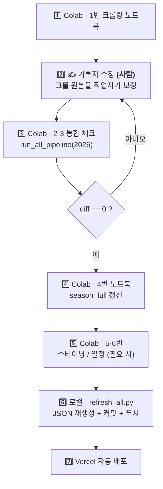

### 명단 입력 (올스타 · 국가대표 · 해외 입단)

**원본은 Drive 엑셀이 아니라 저장소(Upstash)입니다.** 관리 화면 `/admin/rosters` 에서 넣고,
저장하면 배포 없이 공개 화면에 바로 뜹니다. 드래프트 지명자(`/admin/draft`)와 같은 구조입니다
— 구운 JSON 위에 저장소의 연도를 덮어서 보여주므로, 저장소가 비거나 죽어도 구운 파일로 뜹니다
(`web/app/lib/rosters.ts`).

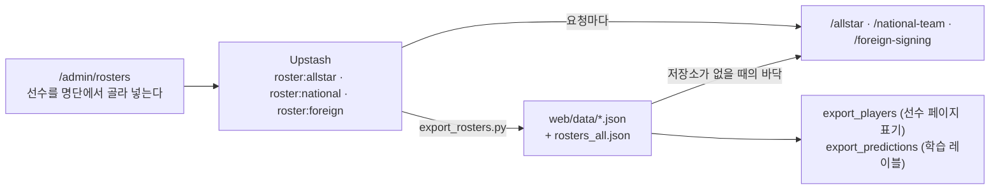

- **person_no 추정이 사라졌습니다.** 예전에는 엑셀에 선수 번호를 적을 수 없어
  `_roster_match.py` 가 성명·학교명·학년·포지션으로 사람을 찾고, 못 찾으면 경고만 찍고
  넘어갔습니다. 이제는 화면에서 그 해 명단을 검색해 고르므로 번호가 처음부터 확정됩니다.
- **임시 저장**(`published: false`)으로 두면 저장소에는 들어가되 공개 화면에도, 구운 JSON
  에도 안 나갑니다. 발표 전 명단을 미리 넣어 두는 자리입니다.
- 저장할 때마다 직전 내용이 `roster:history:<종류>:<연도>` 에 20개까지 쌓입니다.

**엑셀에 쌓아 둔 과거 명단 이관 (한 번만)**

```bash
python scripts/import_rosters_to_kv.py --dry-run   # 무엇이 옮겨질지 먼저 본다
python scripts/import_rosters_to_kv.py             # 저장소에 없는 해만 옮긴다
python scripts/export_rosters.py                   # 구운 JSON 도 맞춰 둔다
```

옮기면서 예전 `export_*.py` 가 하던 매칭을 **한 번만** 하고 그 결과를 저장합니다. 이미
저장소에 있는 해는 건드리지 않습니다(`--overwrite` 로 덮을 수 있음).

> [!NOTE]
> 엑셀에서 명단을 굽던 옛 스크립트(`export_allstar.py` · `export_national_team.py` ·
> `export_foreign_signing.py`)는 2026-10-06 에 지웠습니다. 무심코 돌리면 관리 화면에서 넣은 것이
> 엑셀 내용으로 덮이는 위험만 남아 있었습니다. 필요하면 git 기록에서 꺼낼 수 있습니다.

### 필요한 자격증명

| 위치 | 내용 |
| :-- | :-- |
| `secrets/secrets.toml` | GCP 서비스 계정 개인키(`gcp_service_account`). **절대 커밋 금지** |
| `secrets/secrets.toml` | `[upstash]` `url`/`token` — 명단 이관·굽기용. env `UPSTASH_REDIS_REST_URL`/`_TOKEN` 으로 대신해도 됩니다 |
| Vercel env | `SESSION_SECRET` · `GOOGLE_CLIENT_ID/SECRET` · `AUTH_ORIGIN` · `ADMIN_ID/PASSWORD` · `UPSTASH_REDIS_REST_URL/TOKEN` |

### 커밋 · 배포 제약

- 배포는 web 저장소의 GitHub Actions(`.github/workflows/deploy.yml`)가 소유자 토큰으로 합니다.
  그래서 **커밋 author 가 누구든 배포됩니다**(예전 Vercel Git 연동 시절의 "author 는 반드시
  `Ryong1001`" 제약은 사라졌습니다). `refresh_all.py` 의 author 검사만 남아 있어 팀원은
  `--allow-any-author` 를 붙입니다. 자세한 건 [ONBOARDING 7절](ONBOARDING.md#7-배포).
- `web/` 은 별도 저장소라 루트 `.gitignore` 에서 제외돼 있습니다. 여기서 추적하면
  gitlink(`160000`)로만 기록돼 내용이 정작 백업되지 않습니다.
- Vercel 프리뷰는 배포마다 URL이 달라 구글 OAuth 가 거부하므로, Preview 환경에는
  **브랜치 고정 주소**를 `AUTH_ORIGIN` 에 넣습니다.

---

## 🚧 알려진 한계 · 남은 일

### 한계

- **정적 스냅샷** — 투구수 관리는 export 시점(KST 오늘)으로 기준일이 고정됩니다.
  라이브로 기준일을 바꿔가며 볼 수 없습니다.
- **개별 상대전적**(상대 팀의 개별 선수 기록)은 스냅샷 한계로 빠졌습니다. 팀 단위만 제공.
- **전국대회 순위표**는 토너먼트라 경기 수가 적어 승률 순위의 의미가 약합니다(프론트 경고 문구).
- **파크팩터**는 아직 한계가 남은 실험이라 관리자·파트너만 봅니다(2024·2025 구장명 잘림).
- **WBSC 라인**은 U-18 대회 기록과 2026 경기 상세만 웹에 들어가 있습니다.
- **웹 함수 크기** — 거의 모든 페이지가 `data/` 전체(약 377MB)를 같이 싣고 배포됩니다. 페이지마다
  필요한 파일을 `next.config.ts` 에 적은 뒤 미리보기에서 전부 확인하고 끄는 작업이 남아 있습니다.

### 남은 일

- [ ] 기록 오류 제보 폼 ↔ 관리 화면 제보 목록 연결
- [ ] 계정 차단/해제 버튼 *(판정은 들어가 있고 화면만 없음)*
- [ ] 관리 화면의 데이터 갱신 버튼 *(`/api/export` 는 아직 `EXPORT_KEY` 로만 호출)*
- [ ] 용어사전(`StatInfo.tsx`)의 OBP·OPS 리그 눈금 하드코딩 → `export_rankings` 자동 생성으로 교체
- [ ] 랭킹 페이지의 (이름, 팀) 중복쌍 분리 *(팀 페이지는 완료)*
- [ ] 선수 마스터의 낡은 학교명 20명 · `person_no` 오배정 정리
- [x] 과거 U-18 국가대표 명단(2022~2025)으로 가산치를 데이터로 맞춤 *(2026-10-27, `fit_national_bonus`)*
- [ ] 2028 드래프트로 국가대표 가산치 첫 깨끗한 검증

---

<div align="center">
<sub>

문서가 코드와 어긋나면 코드가 옳습니다. 구조를 바꿀 때 이 문서도 같이 고쳐 주세요.

</sub>
</div>
