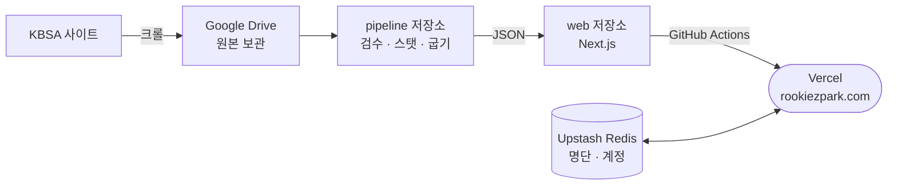

# Rookiezpark 프로젝트 구조

> Team DRAFT LAB 졸업작품 · 2026-10 기준
> 고교야구 기록을 **수집 → 검수 → 분석 → 예측**하고 웹 서비스 [rookiezpark.com](https://rookiezpark.com)으로 공개합니다.

이 문서는 저장소를 처음 여는 분(팀원, 교수님, 심사위원)이 **무엇이 어디에 있는지** 빠르게 파악하도록 정리한 지도입니다.
설계와 운영의 자세한 내용은 [README.md](README.md)에, 설치 방법은 [ONBOARDING.md](ONBOARDING.md)에 있습니다.

---

## 1. 저장소 두 개

| 저장소 | 담은 것 | 언어 |
| :-- | :-- | :-- |
| **highschool-stats-pipeline** (이 저장소) | 크롤링·검수 노트북, 스탯 엔진, 익스포트 스크립트, 예측 모델, 문서 | Python · Jupyter |
| **highschool-stats-web** | 웹 사이트(Next.js)와 사이트가 읽는 구운 JSON | TypeScript · React |

web 저장소는 pipeline 저장소 안의 `web/` 자리에 클론해 씁니다. 익스포트 스크립트가 그 경로에 JSON을 굽기 때문입니다.
pipeline 쪽 `.gitignore`가 `web/`을 제외하므로 두 저장소가 섞이지 않습니다.



---

## 2. 데이터가 흐르는 순서

| 단계 | 어디서 | 무엇으로 | 나오는 것 |
| :-- | :-- | :-- | :-- |
| ① 수집 | Google Colab | `1. KBSA_크롤링…ipynb`, `5.`·`6.` 노트북 | 기록지 xlsx, 박스스코어 |
| ② 보정 | 사람 (엑셀) | Drive의 기록지 | 손으로 고친 기록지 |
| ③ 검수 | Google Colab | `2-3. 통합 체크…ipynb` → `run_all_pipeline(연도)` | 공식 기록과 3중 대조 → `season_full` |
| ④ 스탯·굽기 | 로컬 PC | `lib/` + `scripts/refresh_all.py` | `web/data/**.json` (약 33,000개) |
| ⑤ 공개 | Vercel | web 저장소 | rookiezpark.com |

③에서 공식 기록과 차이가 남으면 ②로 돌아가 다시 고칩니다. 차이가 0이 되어야 다음 단계로 넘어갑니다.

---

## 3. pipeline 저장소 (이 저장소)

```
졸업작품/
├── 1. ~ 6. *.ipynb        ① 수집 · ③ 검수 노트북 (Colab에서 실행)
├── 000. 원격 갱신 (Colab).ipynb   밖에서 태블릿으로 데이터 갱신·배포
├── 검수 코드 동기화 검사.ipynb      같은 전처리 코드가 노트북 세 곳에서 갈라지지 않았는지 검사
│
├── lib/                   스탯 엔진 (순수 pandas)
│   ├── stats.py           wOBA·wRC+·FIP·RE24·도루 — 핵심
│   ├── win_expectancy.py  승리확률 · WPA · LI
│   └── pitch_limit.py     KBSA 투구수 제한 규정
│
├── scripts/               익스포트 · 운영
│   ├── refresh_all.py     13단계를 순서대로 돌려 web/data 를 굽는 진입점
│   ├── export_*.py        화면별 JSON 굽기 (rankings, players, games, draft …)
│   ├── export_predictions.py   드래프트 예측 모델 학습·예측
│   ├── score_predictions.py    드래프트 후 예측 채점
│   ├── setup.py           설치 한 줄 (역할 선택 → web 클론·패키지 설치)
│   └── _*.py              공용 도우미 (Drive 접근, 팀명 정리, 병렬 실행 …)
│
├── 모델/                   드래프트 예측 모델링 노트북 (타자 · 투수)
├── 분석/                   파크팩터 · 주루(BsR) · oWAR · 상대 수준 보정 등 분석 스크립트
├── 카드/                   인스타그램 카드 생성 스크립트
├── data/                  로마자 표기 · 신인 계약금 등 보조 자료
├── docs/manual/           운영 매뉴얼 PDF (사용자용 · 관리자용)
├── logo/                  로고 · 파비콘
│
├── README.md              전체 설계 · 파이프라인 · 운영 (가장 자세함)
├── ONBOARDING.md          처음 합류했을 때 따라 할 것
├── 팀원_매뉴얼.md           Drive 연결 · 커밋 · 푸시 단계별 안내
└── 스탯_설명_및_계산식.md    사이트 지표 정의와 계산식
```

Drive에서 다시 받을 수 있는 대용량 사본(`local_mirror/`, `wbsc/`)과 영상 파일은 저장소에 넣지 않습니다.

---

## 4. web 저장소

```
web/
├── app/                       Next.js App Router — 폴더 하나가 화면 하나
│   ├── page.tsx               홈
│   ├── rankings/ clutch/ tracking/          선수 — 리더보드 · 클러치 · 트래킹
│   ├── standings/ team/ depth-chart/ pitch-watch/   팀 — 순위 · 팀 기록 · 뎁스차트 · 투구수 관리
│   ├── games/                 게임피드 (이닝별 중계 · 승리확률)
│   ├── draft/ national-team/ allstar/ foreign-signing/   드래프트 · 국가대표 · 올스타 · 해외 입단
│   ├── board/                 커뮤니티
│   ├── predict/               드래프트 예측 (비밀번호 잠금, 예측 데이터는 _data/ 에 서버 전용)
│   ├── admin/                 관리 화면 (관리자 전용)
│   ├── api/                   API 라우트 — 브라우저는 여기서 잘라 준 조각만 받음
│   ├── components/            공용 화면 부품 (상단 메뉴 · 표 · 차트 …)
│   └── lib/                   서버 공용 코드
│       ├── data.ts            web/data 의 JSON 읽기 (서버에서만)
│       ├── auth.ts session.ts 로그인 · 서명 쿠키 세션
│       ├── rate-limit.ts      API 요청 제한
│       └── seasons.ts         공개 시즌 범위 (PUBLIC_SEASONS)
├── data/                      pipeline 이 구운 JSON — public 밖이라 URL로 직접 못 받음
├── public/                    로고 등 정적 파일
├── .github/workflows/deploy.yml   푸시 → lint → 타입 검사 → Vercel 배포
├── README.md                  웹 개발 방법
└── AUTH.md                    로그인 4등급 · 세션 설계
```

웹은 기록을 계산하지 않고, pipeline이 구운 JSON을 보여주기만 합니다.

---

## 5. 직접 실행해 보기

```powershell
git clone https://github.com/Ryong1001/highschool-stats-pipeline.git 졸업작품
cd 졸업작품
python scripts/setup.py --role web     # web 저장소 클론 + 패키지 설치
cd web
npm run dev                            # http://localhost:3000
```

web 저장소에 구운 JSON이 함께 들어 있어서, 웹 화면은 클론만으로 실데이터로 뜹니다.
데이터를 새로 굽는 일(`refresh_all.py`)은 Google Drive 서비스 계정 키가 있어야 해서 파이프라인 담당만 할 수 있습니다.

---

## 6. 읽는 순서 추천

| 보고 싶은 것 | 볼 곳 |
| :-- | :-- |
| 전체 설계를 한 장으로 | [README.md](README.md) 맨 앞 '한 눈에 보는 설계도' |
| 데이터 검수 방법 | `2-3. 통합 체크 (아웃·점수 + 주자상황).ipynb`, README '계층 2' |
| 지표 계산 | [lib/stats.py](lib/stats.py), [스탯_설명_및_계산식.md](스탯_설명_및_계산식.md) |
| 드래프트 예측 모델 | [scripts/export_predictions.py](scripts/export_predictions.py), README '드래프트 예측 모델' |
| 모델 비교 · SHAP 해석 · 오류 분석 | [분석/모델_비교_실험.py](분석/모델_비교_실험.py), 결과는 `분석/모델_비교_결과.json` |
| 시간순 검증 · 신뢰구간 · 예측 등급 근거 | [분석/시간순_검증.py](분석/시간순_검증.py), 결과는 `분석/시간순_검증_결과.json` |
| 웹 데이터 보호 구조 | web 저장소 `app/lib/data.ts`, `app/api/`, `AUTH.md` |
